# Deteksi Tangga dan Manusia dengan YOLO26n

Selvia Ramanda | NIM 4222411057 | Robotika Malam B | RET503 Computer Vision and Deep Learning

Sistem deteksi objek berbasis webcam yang mengenali dua kelas, `stair` (tangga) dan `person` (manusia),
lalu menandai tangga yang terhalang manusia dengan aturan tumpang tindih kotak (bukan kelas ketiga).

Repo ini terpisah dari `YOLO_Tangga_Manusia` (kamera Logitech, foto diambil tanpa tinggi dan posisi yang konsisten).
Di sini pengambilan data distandarkan: webcam baru, tinggi tetap 40 cm, resolusi 640x480, dan kalibrasi ulang
untuk webcam ini. Angka hasil di bawah berasal dari dataset baru dan tidak bisa dibandingkan langsung
dengan repo lama.

## Ringkasan data

- Kamera: webcam baru, tinggi 40 cm dari lantai, resolusi 640x480, sesi cahaya redup dan terang.
- Dataset: 360 foto. Kotak label: `person` 779, `stair` 357.
- Pembagian: train 251, val 72, test 37 (sidik jari label `D9B350CEE391`).
- Kalibrasi kamera: 41 dari 45 foto papan catur terdeteksi, RMS 0,311 piksel. Distorsi kecil,
  jadi koreksi (undistort) tidak dipakai.
- Pelabelan: Roboflow. Aturan: kotak tangga mencakup seluruh tangga termasuk bagian yang tertutup orang.

## Hasil Eksperimen YOLO

**Lingkungan pengujian:** Google Colab, Tesla T4, Ultralytics 8.4.182

### Perbandingan Hasil Eksperimen

| Eksperimen | Perubahan | mAP50 (val) | mAP50-95 (val) |
|---|---|---:|---:|
| E1 - Pretrained | Pengaturan dasar (`imgsz=416`) | 0.946 | 0.767 |
| E2 - Scratch | Tanpa bobot pretrained | 0.724 | 0.423 |
| E3 - Tuning | `imgsz=640` | 0.963 | 0.786 |

**Model terpilih:** E3, karena memperoleh nilai mAP50-95 validasi tertinggi.

Pada data test yang digunakan satu kali, E3 memperoleh mAP50 sebesar 0.958 dan mAP50-95 sebesar 0.799.

Selisih performa E3 dan E1 relatif kecil. Karena setiap eksperimen hanya dilatih satu kali, hasil ini belum cukup untuk memastikan peningkatan yang konsisten.

### Visualisasi Dataset

Gambar berikut digunakan untuk mendokumentasikan distribusi label dan contoh data training.

### 1. Dataset Visualization

#### Label Distribution
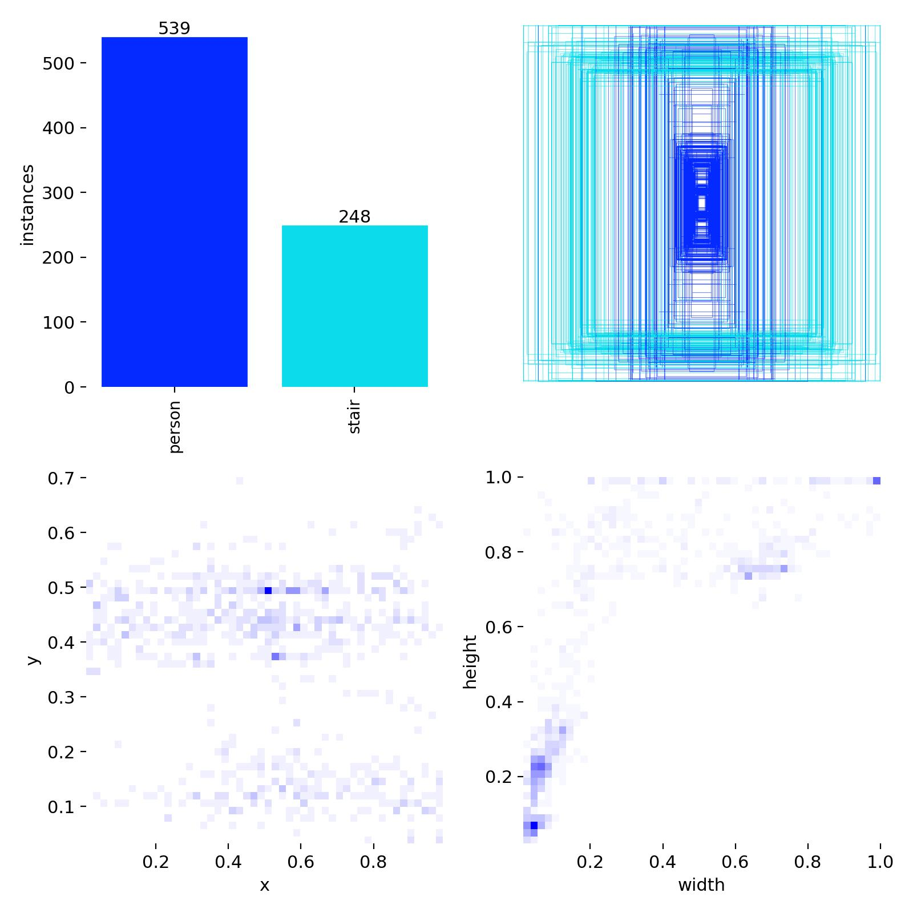

### 2. Training Visualization

#### Training Batch 0
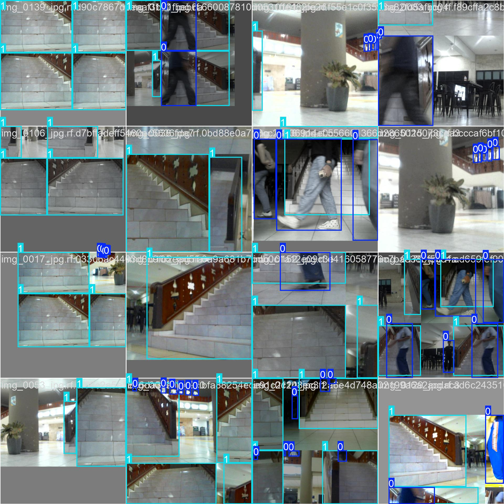

#### Training Batch 1
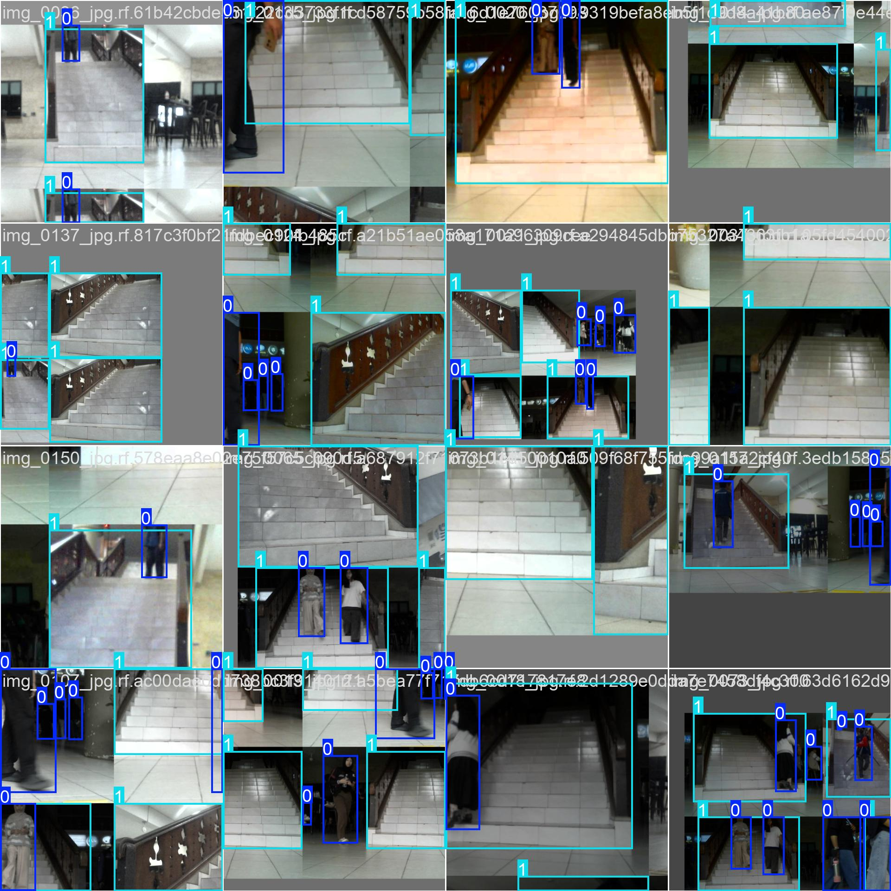

#### Training Batch 2
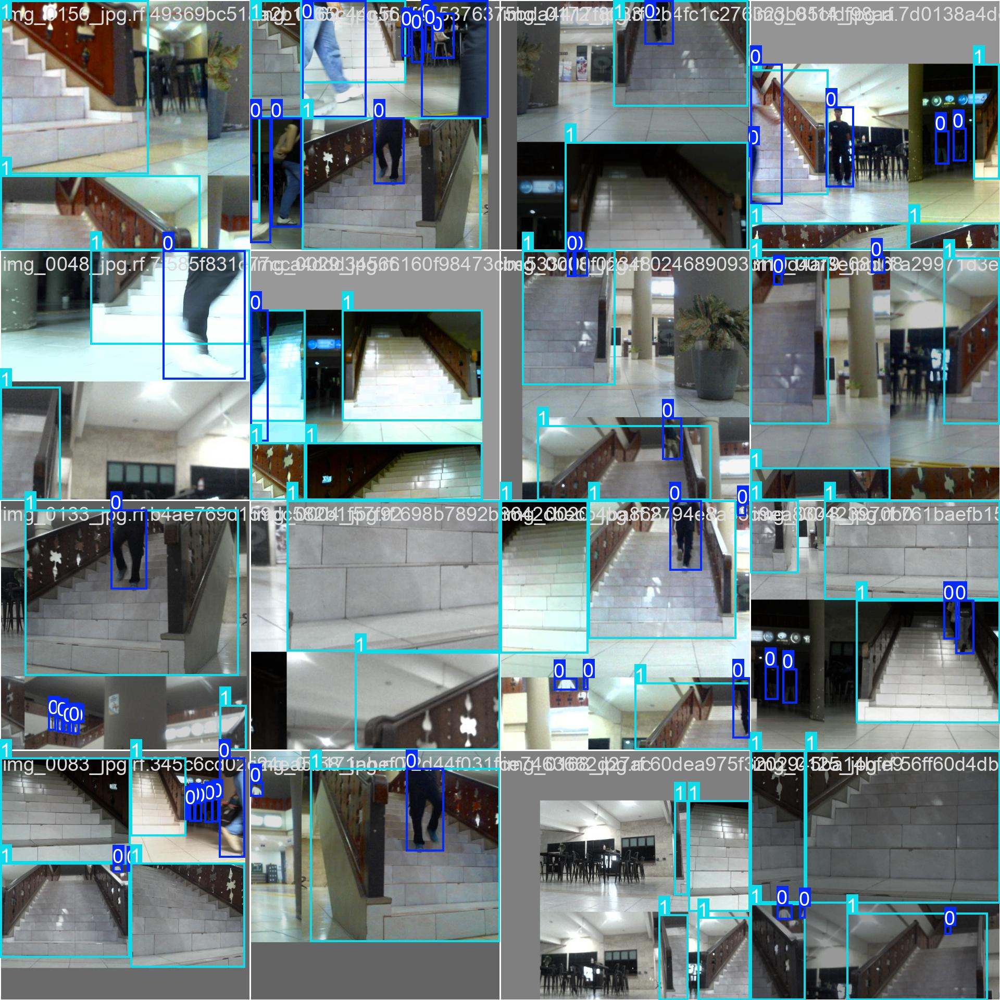

#### Training Results
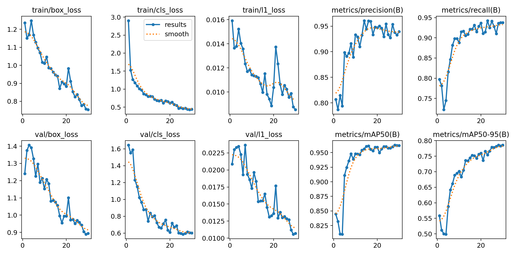

### 3. Model Evaluation

#### Confusion Matrix
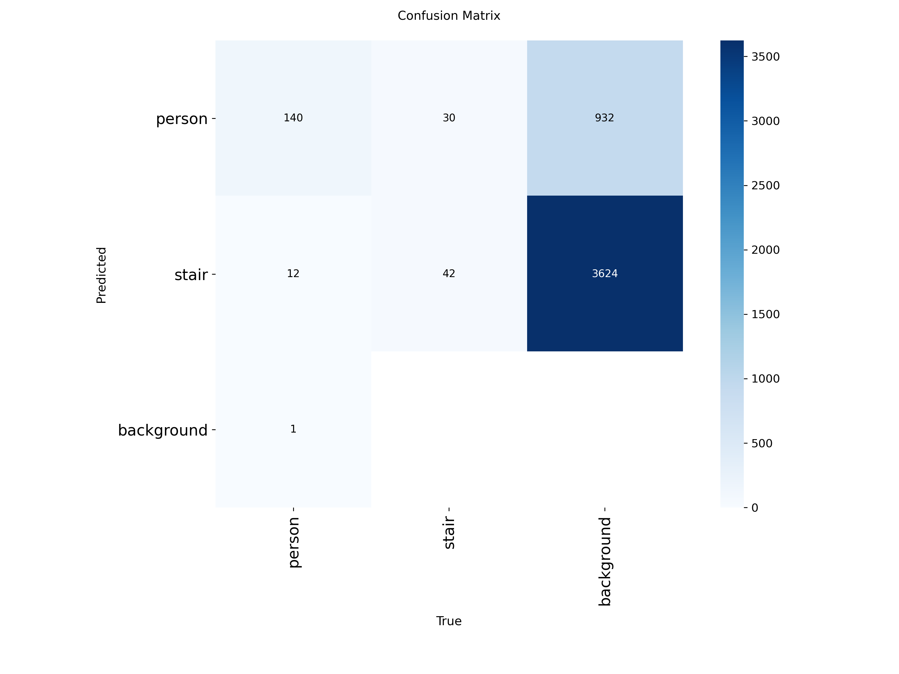

#### Normalized Confusion Matrix
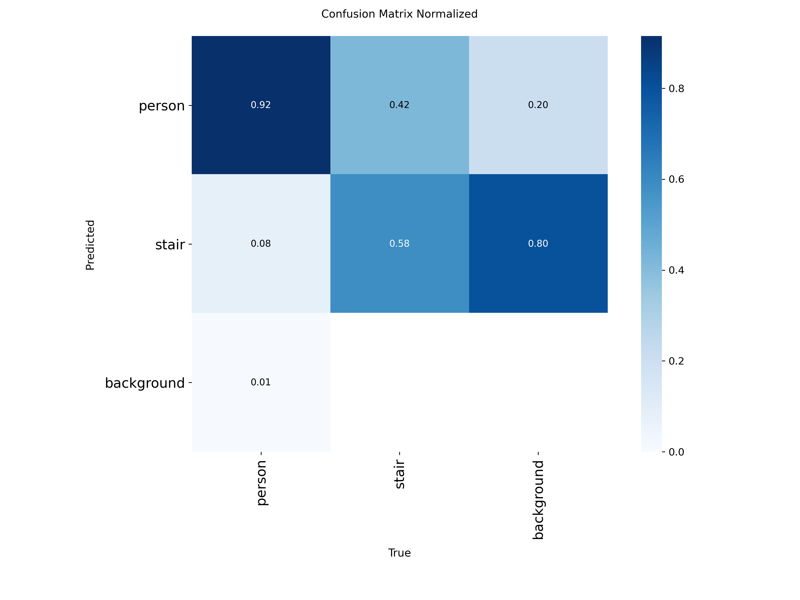

#### Precision-Recall Curve
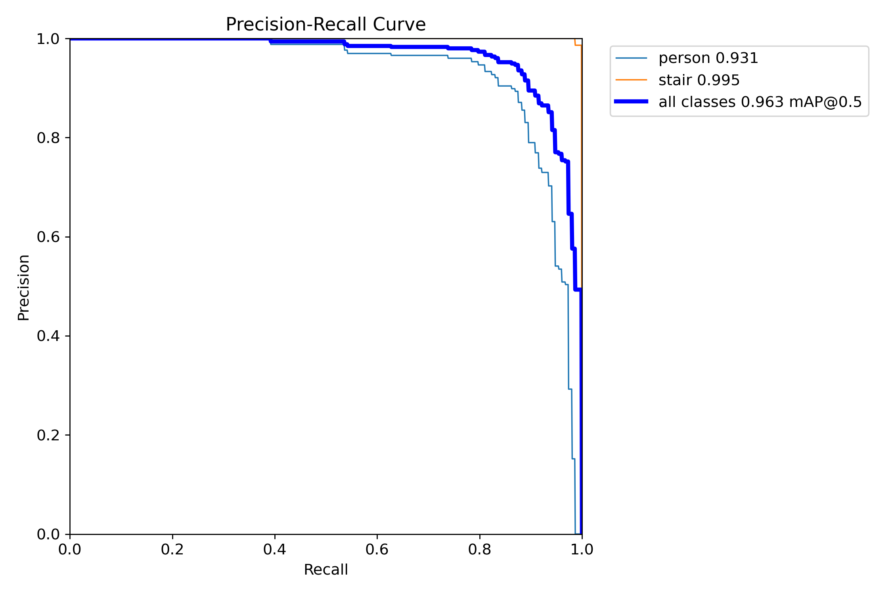

#### F1 Curve
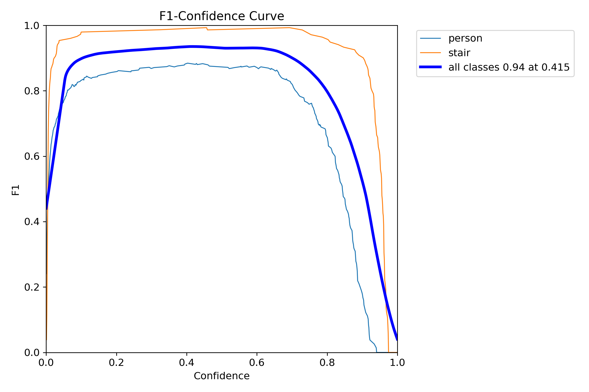

#### Precision Curve
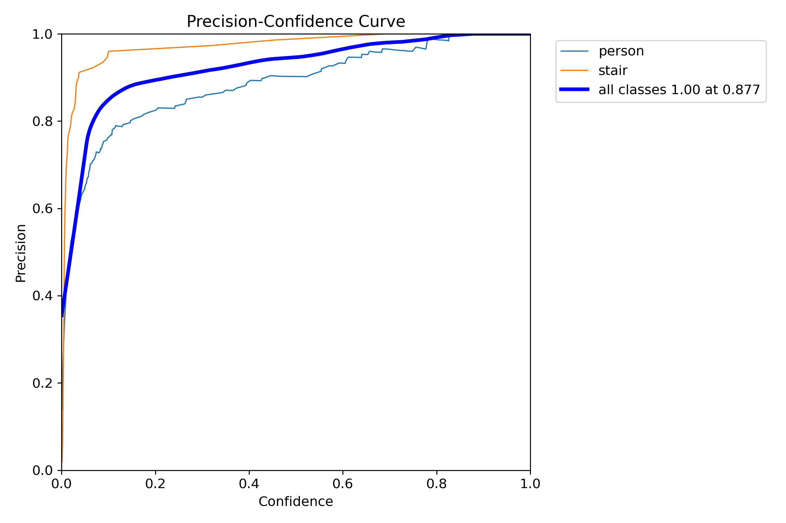

#### Recall Curve
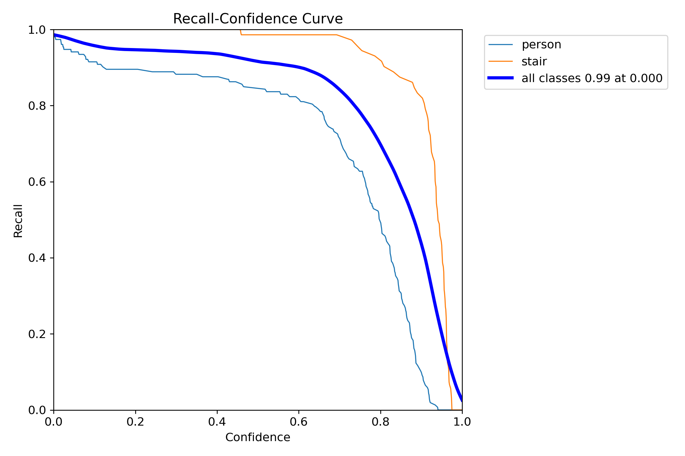

### 4. Evaluasi Deteksi Status Terhalang

Acuan status terhalang ditentukan berdasarkan kotak label, sedangkan prediksi model ditentukan berdasarkan kotak deteksi dengan `conf=0.4`.

| Dataset | TP | FP | FN | TN | Presisi | Recall |
|---|---:|---:|---:|---:|---:|---:|
| Validasi | 12 | 5 | 0 | 55 | 0.706 | 1.000 |
| Test | 4 | 0 | 0 | 33 | 1.000 | 1.000 |

Ambang tumpang tindih (IoU) yang digunakan adalah 0.3.

**Catatan:** Hasil test hanya mencakup empat foto terhalang. Oleh karena itu, nilai presisi dan recall pada test belum cukup untuk dijadikan klaim performa yang kuat.

## 🎥 Video Demonstrasi Robot

Klik video berikut untuk melihat demonstrasi robot.

**Hasil uji langsung dengan webcam:**

[▶️ Tonton Video Demonstrasi](https://youtu.be/Z78DmsSWWf0)


## Keterbatasan

- Dataset kecil dan kemungkinan berasal dari satu lokasi dan satu tangga.
- Pembagian data acak per frame, sehingga foto yang mirip bisa masuk ke train dan test sekaligus.
- Tidak ada gambar latar tanpa objek, sehingga tebakan palsu di ruang kosong lebih mungkin.
- Kelas `person` lebih lemah daripada `stair` (terlewat dan tebakan palsu lebih banyak).
- Akurasi status terhalang diukur terhadap acuan dari label, bukan penilaian manusia.

## Struktur folder

```
scripts/          skrip siapkan data dan latih (00 sampai 06, capture_dataset.py)
data/dataset_v1/  dataset terbagi (images, labels, data.yaml)
hasil_training/   hasil_praktik (E1, E2, E3) dan tabel hasil .txt/.csv
realtime/         realtime.py dan best.pt (model E3)
kalibrasi/        skrip dan hasil kalibrasi webcam baru
```

## Cara menjalankan

1. Siapkan data dari Roboflow (format YOLO): `python 00_siapkan_dari_roboflow.py dataset_roboflow dataset_yolo`
2. Cek label: `python 01_cek_anotasi.py dataset_yolo`
3. Bagi data: `python 05_split_dataset_yolo.py dataset_yolo dataset_v1`
4. Latih (Colab, GPU): `python 06_latih_bandingkan.py --nim <NIM> --nama "<Nama>" --data /content/dataset_v1/data.yaml`
5. Uji langsung: letakkan `best.pt` satu folder dengan `realtime.py`, lalu `python realtime.py` (tekan `q` untuk keluar).

Catatan:

- Baris `path:` di `data/dataset_v1/data.yaml` mengikuti lokasi saat dibuat. Ubah sesuai lokasi Anda sebelum melatih.
- Jangan menjalankan ulang langkah 3 tanpa menyimpan `dataset_v1` asli, karena pembagian acak bisa berubah
  dan angka di atas tidak lagi sebanding.
- Urutan kelas: `0 = person`, `1 = stair`. Jangan memakai bobot dari proyek lain yang urutan kelasnya berbeda.

## Sumber dan atribusi

- Skrip `01_cek_anotasi.py`, `02_yolo_ke_coco.py`, `03_coco_ke_yolo.py`, `05_split_dataset_yolo.py`, dan
  `06_latih_bandingkan.py` berasal dari materi praktikum RET503 (dosen pengampu).
- `00_siapkan_dari_roboflow.py`, `capture_dataset.py`, `realtime.py`, dan skrip kalibrasi disiapkan untuk proyek ini.
- Model dasar: Ultralytics YOLO26n (bobot pretrained dari Ultralytics). Pelabelan: Roboflow.

## Privasi

Dataset memuat foto orang yang tampak saat pengambilan data. Jika Anda tampak di salah satu foto dan ingin
foto itu dihapus, hubungi pemilik repo dan fotonya akan dihapus.
